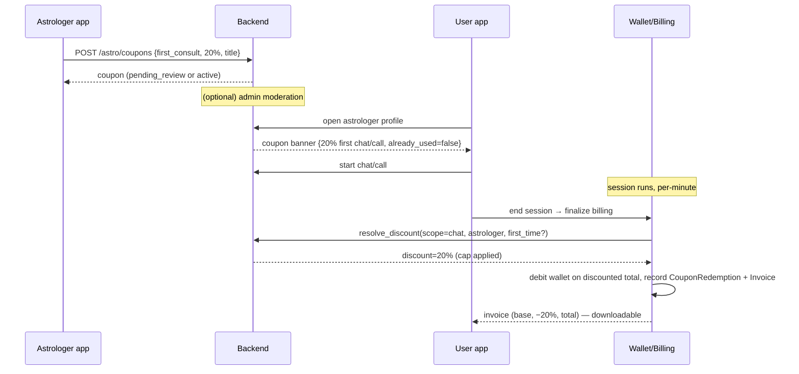
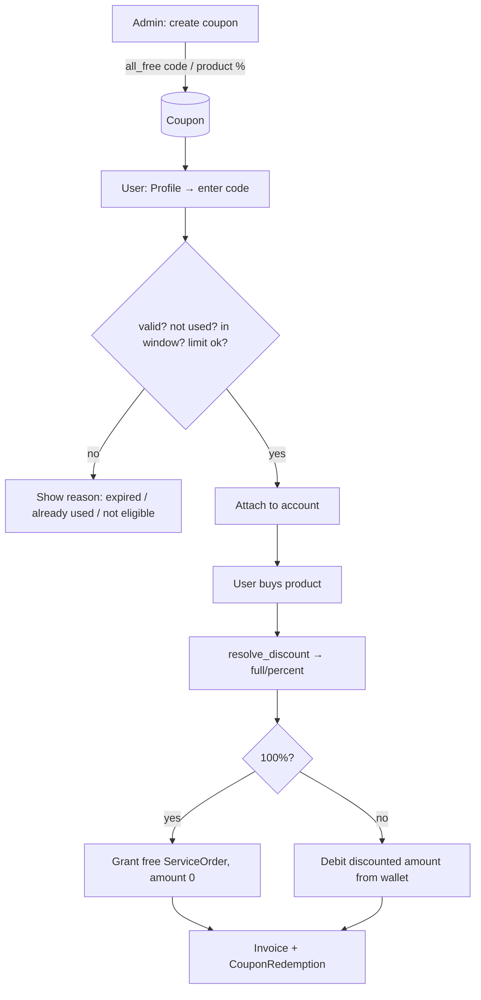
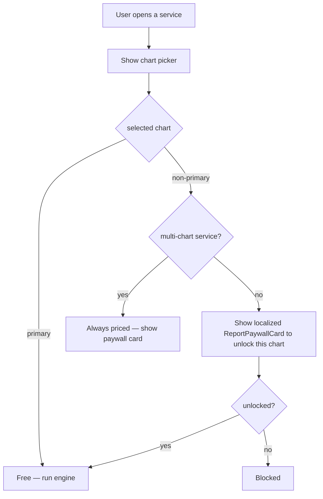

# Coupon & Discount Management — Design Spec

**Status:** DESIGN / proposal (no code yet — for review)
**Scope:** Astrologer-issued coupons, admin/platform coupons, product & consultation discounts, downloadable invoices, international 5× pricing, and the primary-chart free rule.
**Non-negotiable:** No astrology calculation, scoring, dasha, transit, remedy or confidence logic is touched. This is billing / access / presentation plumbing only.

---

## 1. What we should build (recommendation in one paragraph)

Build **one unified coupon engine**, not two. A single `Coupon` table carries an `owner_type` of `platform` (admin) or `astrologer`, one `CouponRedemption` ledger, and one discount-resolution function that every money path calls right before it debits the wallet (consultation billing, product purchase, IAP verify). Coupons target **products** (ServicePricing keys), **consultations** (chat/call/video), or **everything**; discount kinds are **percent / flat / 100%-free**. Add an `Invoice` record for every completed billable event so users can view and download a receipt. Reuse the existing 5× INR→USD rule (`app/core/pricing.py`) so international users see 5× rates for consultations too, with the coupon percentage applied after conversion. Everything is admin-controllable, and every coupon carries localized text (title/description) for all 23 languages. This keeps accounting clean, prevents double-discounting, and gives admin one report surface for coupons + transactions.

---

## 2. Requirements → design mapping

| # | Your requirement | Design element |
|---|---|---|
| 1 | Astrologer creates a first-time-user discount coupon (localized) | `Coupon(owner_type=astrologer, kind=first_consult)`, `title_i18n`, admin-approvable |
| 2 | User sees coupon on astrologer profile; "already used" message; % off call/video/chat billing | Profile coupon banner via `GET /astrologers/{id}/coupon`; discount applied in consultation finalization |
| 3 | Invoice of used service in profile/wallet, downloadable | `Invoice` model + `GET /me/invoices`, `GET /me/invoices/{id}.pdf` |
| 4 | International users see 5× the astrologer's charge; astrologer can set with 5× | Extend `pricing.py` 5× rule to consultation rates (`consultation_pricing()`) |
| 5 | All reports in admin with txn logs + coupons | Admin Coupons CRUD + Redemptions report + Transactions report + CSV export |
| 6 | User "special coupon code" → 100% free on all products; product-wise discount coupons; admin-controlled | `Coupon(kind=all_free / product)`, redeemed in user profile, admin-issued |
| 7 | Full control of coupons: direct (admin→user) and astrologer→user | Unified engine + admin moderation + astrologer self-serve create |
| 8 | Fix birth-chart primary rule; free primary for all single-chart services; paywall others; multi-chart excluded; localized picker | `PrimaryChart` rule refinement + chart-picker paywall (already partly built) |
| 11 | Suggestion + workflow + this .md | This document |

---

## 3. Data model (new tables + minimal changes)

### 3.1 `Coupon`
```
id                UUID PK
code              VARCHAR(40) UNIQUE           # user-facing code (uppercased); NULL for auto first-consult offers
owner_type        VARCHAR(12)                  # platform | astrologer
owner_id          UUID NULL                    # astrologer_profile.id when owner_type=astrologer
kind              VARCHAR(20)                  # first_consult | product | consultation | all_free | flat
discount_type     VARCHAR(10)                  # percent | flat | full(=100%)
discount_value    NUMERIC(10,2)                # 20 => 20% or ₹20 depending on discount_type; ignored for full
max_discount_amt  NUMERIC(10,2) NULL           # cap for percent coupons (₹, base currency)
min_order_amt     NUMERIC(10,2) NULL           # minimum billable before coupon applies
applies_to        JSON NULL                    # service_keys list for product coupons; NULL = all; ["chat","call","video"] for consultation
first_time_only   BOOLEAN default true         # only if user has no prior completed txn in this scope
per_user_limit    INT default 1                # redemptions per user (1 = once)
max_redemptions   INT NULL                     # global cap (budget guard); NULL = unlimited
redeemed_count    INT default 0                # denormalized counter (atomic increment)
funded_by         VARCHAR(12)                  # astrologer | platform  (who bears the discount — see §5)
starts_at         DATETIME NULL
expires_at        DATETIME NULL
status            VARCHAR(12) default 'active'  # active | paused | expired | pending_review | rejected
title_i18n        JSON                         # {"english":"...", "hindi":"...", ...}
description_i18n  JSON NULL
created_by        UUID                         # admin or astrologer user id
created_at / updated_at
```

### 3.2 `CouponRedemption` (ledger — the source of truth for "used")
```
id                UUID PK
coupon_id         UUID FK
user_id           UUID FK
astrologer_id     UUID NULL                    # for astrologer/consultation coupons
context_type      VARCHAR(20)                  # service_order | chat_session | call_session
context_id        UUID                         # the order/session it discounted
base_amount       NUMERIC(10,2)                # pre-discount billable (base currency)
discount_amount   NUMERIC(10,2)                # actual discount applied
currency          VARCHAR(3)                   # INR | USD (display); ledger stays INR
funded_by         VARCHAR(12)                  # snapshot at redemption
created_at
UNIQUE(coupon_id, user_id, context_id)         # idempotency
INDEX(coupon_id, user_id)                       # per-user-limit checks
```

### 3.3 `Invoice`
```
id                UUID PK
invoice_no        VARCHAR(24) UNIQUE           # NKL-2026-000123 (sequence)
user_id           UUID FK
kind              VARCHAR(20)                  # consultation | product | wallet_recharge
context_type      VARCHAR(20)                  # chat_session | call_session | service_order
context_id        UUID
currency          VARCHAR(3)                   # settlement currency (INR / USD)
line_items        JSON                         # [{label, qty, unit, amount}]
base_amount       NUMERIC(10,2)
discount_amount   NUMERIC(10,2) default 0
coupon_code       VARCHAR(40) NULL
tax_amount        NUMERIC(10,2) default 0      # GST placeholder (0 until configured)
total_amount      NUMERIC(10,2)
astrologer_name   VARCHAR(150) NULL
issued_at         DATETIME
snapshot          JSON                         # frozen billing detail for reproducible rendering
```

### 3.4 Changes to existing tables (additive — schema_sync friendly)
- `CallSession` / `ChatSession`: add `coupon_id`, `discount_amount`, `invoice_id` (nullable).
- `ServiceOrder`: add `coupon_id`, `discount_amount`, `invoice_id` (nullable).
- `Chart`: no new column needed — `is_primary` + `category` already exist (§7).
- `AstrologerProfile`: no change; consultation 5× is computed, not stored.

> All additions are nullable / defaulted, so the existing `schema_sync` auto-adds columns on deploy — no manual migration.

---

## 4. Discount resolution (the one function everyone calls)

`resolve_discount(db, user, scope, base_amount_inr, *, astrologer_id=None, service_key=None, code=None) -> DiscountResult`

Steps:
1. Gather **candidate coupons**: an explicit `code` (user-entered), the astrologer's active `first_consult` coupon (if `astrologer_id`), and any admin platform coupons valid for this scope.
2. Filter by: `status=active`, window (`starts_at`/`expires_at`), `applies_to` matches scope/service_key, `min_order_amt`, `first_time_only` (no prior completed txn in scope — see §4.1), `per_user_limit` not exhausted (`CouponRedemption` count), `max_redemptions` not hit.
3. **No stacking** — pick the single best-value coupon (highest discount for the user). An explicit user-entered `code` wins over auto-suggested ones.
4. Compute discount: `percent → min(base*value/100, max_discount_amt)`, `flat → min(value, base)`, `full → base`.
5. Return `{coupon_id, discount_amount, funded_by, final_amount}`. Caller records a `CouponRedemption` **inside the same DB transaction** as the wallet debit (atomic; unique constraint prevents double-spend on retry).

### 4.1 "First-time" definition
`first_consult` / `first_time_only` is satisfied when the user has **no prior `completed` CallSession or ChatSession with that astrologer** AND no prior redemption of that coupon. For product `all_free`/`product` first-time, use "no prior completed `ServiceOrder` in `applies_to`".

---

## 5. Who pays for the discount (accounting — needs your confirmation)

The discount reduces what the **user** pays. The open question is whose share absorbs it:

| Coupon source | Recommended `funded_by` default | Effect |
|---|---|---|
| Astrologer coupon | **astrologer** | Astrologer earning is computed on the **discounted** net; platform commission on the discounted net. The astrologer funds their own marketing offer. |
| Admin/platform coupon | **platform** | Astrologer earning stays on the **full** rate; the platform absorbs the discount (marketing spend). |
| `all_free` 100% code | **platform** | Platform grants free; if it discounts a consultation, astrologer is still paid full from platform (configurable). |

`funded_by` is a per-coupon field so you can override. **CONFIRMED:** astrologer coupons = astrologer-funded, admin coupons = platform-funded (defaults by owner_type).

---

## 6. International 5× for consultations (requirement 4)

Today product prices convert INR→USD via `pricing.py` (`usd = round_to_tier(inr × MULT ÷ FX)`, MULT default **5**, admin-editable). Consultation rates (`rate_per_min_chat/call/video`) are **INR-only** — an international gap.

Design: a `consultation_pricing(profile, region, fx, mult)` helper mirroring the product `_apply_session_pricing`:
- India → `rate_per_min` in ₹, wallet rail.
- International → session rate = `rate × MULT` shown in USD (tier-rounded), coupon % applied **after** conversion (percentage is currency-agnostic; flat coupons convert too).
- The astrologer sets the **base ₹ rate**; the "5×" is the platform rule they opt into (admin-editable multiplier), matching how products already work.

> **Dependency:** international users cannot recharge the ₹ wallet, so an actual international consultation charge needs the store-IAP / PAPG rail (Payments Phase D, already tracked in `docs/internationalization/PAYMENTS_PHASE_D.md`). Until then we can **display** the USD rate + coupon preview, but live international consultation billing is gated on that phase. India consultations bill immediately.

---

## 7. Primary-chart free rule (requirement 8)

Current: `Chart.is_primary` (bool) + `Chart.category` (self/family/friend/other) exist; the add-chart screen has a "primary" switch subtitled "Used for daily horoscope", and an `extra_chart` paywall exists.

Refinement:
1. **Exactly one primary.** If a primary already exists, the add-chart "primary" switch is **disabled** (with a hint "You already have a free Primary chart"). Making a new chart primary is only allowed if none exists (or via an explicit "change primary" action — recommend keeping it fixed for the free entitlement).
2. **Primary is free for every single-chart service** (kundli sections, all single-chart reports, forecast). Non-primary charts require an unlock (existing `extra_chart` / per-report paywall).
3. **Multi-chart comparison is excluded** from the free rule — Kundli Milan / Relationship / Love-compatibility / Karma-linkage / child-probability always involve a second chart, so they are always priced (the second chart is the "paid" side).
4. **Chart picker at point of use:** when a service needs a chart, show the chart list. Selecting the **primary** → proceed free. Selecting a **non-primary** → show the localized `ReportPaywallCard` to unlock (already built; wire the picker to gate on `is_primary`). Localized for all 23 languages via the existing card catalog.

This is mostly an **entitlement rule + UX gate**, reusing `report_paywall.dart` and the entitlements endpoint — small, low-risk.

---

## 8. Multi-language (requirement 1 & general)

- Coupon `title_i18n` / `description_i18n` are JSON maps keyed by canonical language (`english`, `hindi`, … `japanese`), same scheme as `pricing_cards`.
- Astrologer enters the coupon title in their language; we store it under their locale and **fill the rest with language agents** (the proven 2-lang-per-agent flow) or fall back to the astrologer's original + English. Admin coupons get full agent translation.
- User-facing coupon banner, "already used" message, invoice labels, and the chart-picker paywall all resolve via the existing i18n catalog / `MenuLabels` pattern — English fallback guaranteed.

---

## 9. API surface

**Astrologer (self-serve, `require_role astrologer`)**
- `POST /astro/coupons` — create (kind=first_consult|consultation), title, %; goes `pending_review` if moderation on.
- `GET /astro/coupons` / `PATCH /astro/coupons/{id}` (pause/edit) / `DELETE`.
- `GET /astro/coupons/{id}/stats` — redemptions, revenue impact.

**User**
- `GET /astrologers/{id}/coupon` — the offer to show on the profile (+ `already_used` flag).
- `POST /me/coupons/redeem` — enter a code (validates, attaches to account for `all_free`/product).
- `GET /me/coupons` — my available/used coupons.
- `GET /me/invoices` / `GET /me/invoices/{id}` / `GET /me/invoices/{id}/pdf`.
- Discount is applied automatically inside existing `POST /service/purchase`, `POST /service/iap/verify`, and consultation finalization — the client sends an optional `coupon_code`.

**Admin (`require_role admin`)**
- `GET/POST/PATCH/DELETE /admin/coupons` — full CRUD, incl. `all_free` 100% codes and product coupons.
- `POST /admin/coupons/{id}/moderate` — approve/reject astrologer coupons.
- `GET /admin/coupons/redemptions` — ledger, filterable, CSV export.
- `GET /admin/reports/transactions` — unified wallet + service + consultation txns with coupon column, CSV.
- Kill-switch: `PATCH /admin/coupons/{id}` status=paused.

---

## 10. Admin panel (React)

New screens under `/admin`:
- **Coupons** — table (code, owner, kind, discount, used/limit, status), create/edit modal (all coupon fields, localized title editor, product multi-select, 100%-code generator), moderation queue for astrologer coupons.
- **Redemptions report** — who used what, when, discount amount, funded_by; date filters + CSV.
- **Transactions report** — unified ledger (recharge / consultation / product / coupon), currency split (INR/USD), export. Extends existing comm-logs.
- Coupon column added to existing revenue view.

Follows the existing admin patterns (`services/api.ts` request(), route in `App.tsx`, nav in `AdminShell.tsx`, sonner toasts).

---

## 11. Invoices (requirement 3)

- On every completed billable event (chat/call finalization, `service_order` completion, wallet recharge), create an `Invoice` with a sequential `invoice_no`, line items, discount line (if any coupon), currency, and a frozen `snapshot`.
- User sees them in **Profile → Invoices** and inline in the **wallet statement**.
- Download: server renders the snapshot to HTML → PDF (a lightweight HTML template; reuse the website's brand styles). Endpoint `GET /me/invoices/{id}/pdf`.
- Legally: invoices show Jaikalki Technology Pvt Ltd details (already standardized in the Terms/Website work) + GSTIN placeholder.

---

## 12. Workflows

### 12.1 Astrologer first-time coupon → user consultation


### 12.2 Admin 100%-free code / product coupon


### 12.3 Primary-chart gate at point of use


---

## 13. Edge cases & anti-abuse

- **Idempotency:** `CouponRedemption UNIQUE(coupon_id, user_id, context_id)` + redemption inside the billing DB transaction → no double discount on ret/refresh/retry.
- **Budget guard:** `max_redemptions` atomic check-and-increment; coupon auto-expires when hit.
- **First-time gaming:** derive first-time from completed sessions, not client claim; block if any prior completed session/order in scope.
- **100% code abuse:** admin-only issuance, short expiry, small `max_redemptions`, `per_user_limit=1`, restrict to email-verified users, full audit log, instant kill-switch.
- **Refunds:** if a session/order is refunded, mark the linked `CouponRedemption` reversed and decrement counters.
- **Currency:** ledger stays INR; USD is display via FX. Percentage coupons are currency-safe; flat coupons are stored in ₹ and converted for display.
- **No stacking:** exactly one coupon per transaction; best-value auto-pick, explicit code overrides.
- **Chat-guard synergy:** coupons never expose off-platform contact; astrologer coupon text passes the existing `chat_guard` scan.

---

## 14. Rollout phases

1. **Phase 1 — Core engine (backend):** `Coupon`, `CouponRedemption`, `resolve_discount`, product-purchase integration (`/service/purchase` + IAP), admin CRUD + redemptions report. *(Ships value fastest; products already have a clean money path.)*
2. **Phase 2 — Consultation discounts:** hook `resolve_discount` into chat/call/video finalization; astrologer self-serve coupon create + profile banner + "already used".
3. **Phase 3 — Invoices:** `Invoice` model, generation on all billable events, user list + PDF download.
4. **Phase 4 — International 5× consultations:** `consultation_pricing` helper + USD display (billing rail gated on Payments Phase D).
5. **Phase 5 — Primary-chart rule refinement + localized chart-picker paywall.**
6. **Phase 6 — Multi-language coupon text** (agent-translated) + admin reports polish + CSV export.

Each phase is independently shippable and statically verifiable.

---

## 15. Locked decisions (confirmed)

1. **Discount funding:** astrologer coupons are **astrologer-funded** (discount reduces the astrologer's earning; platform commission on the discounted net). Admin/platform coupons are **platform-funded**. `funded_by` is stored per coupon/redemption for accounting, defaulted by owner_type.
2. **Astrologer coupon moderation:** coupons start `pending_review` and require **admin approval** before users can see/redeem them. Admin can also pause/kill anytime.
3. **100%-free special code:** **single-use per user**, covers **all** Nakshtralogy products, with an **admin-set expiry + max-redemptions budget**, restricted to **email-verified users**. (Not consultations — products only.)
4. **Primary chart:** the first primary is **fixed** as the free entitlement once set — the "primary" switch is disabled once a primary exists (prevents swapping to game free unlocks). Non-primary charts require unlock; multi-chart comparison is always priced.
5. **Stacking:** **no stacking** — one coupon per transaction, best-value auto-pick, explicit user code overrides an auto-suggested one. *(Recommended default; adjust if needed.)*
6. **International consultation billing:** display the USD 5× rate + coupon preview now; **live international consultation charging is gated on Payments Phase D** (₹ wallet can't be recharged internationally). India consultations bill immediately. *(Recommended default; adjust if needed.)*

**Build order:** Phase 1 (product coupons + engine + admin CRUD) → Phase 2 (consultations) → Phase 3 (invoices) → Phase 4 (intl 5×) → Phase 5 (primary-chart rule) → Phase 6 (multi-language + reports polish).
